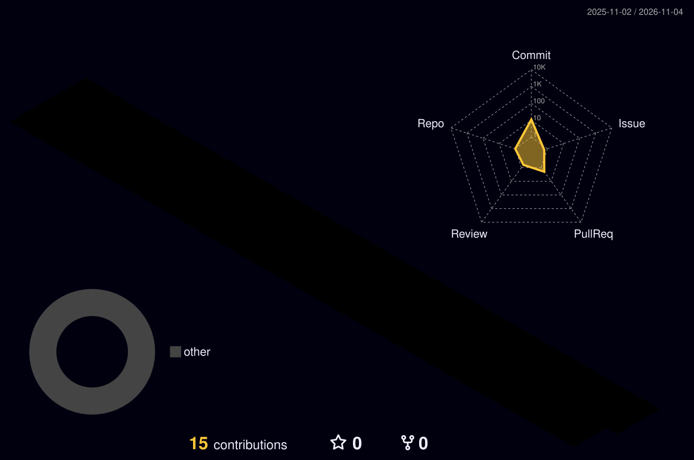

<!-- ===== 3D HEADER ===== -->

  

  

 

<!-- ===== SIDEBAR + CONTENT LAYOUT ===== -->
<table>
<tr>

<!-- ---------- LEFT SIDEBAR ---------- -->
<td width="26%" valign="top" align="center">

### **UpWebTech**
`Digital Solutions Agency`

📍 Varanasi, India
🟢 *Available for projects*

---

**🔗 QUICK LINKS**

---

**⚡ EXPERTISE**

 

</td>

<!-- ---------- RIGHT CONTENT ---------- -->
<td width="74%" valign="top">

## 👨‍💻 About Us

**UpWebTech** ek digital solutions team hai jo businesses ko online grow karne mein help karti hai. Hum design, development aur SEO ko ek saath deliver karte hain, taaki aapki website sirf sundar na ho, **results bhi de**.

> 💡 *"Great websites are not built, they are crafted."*

## 🚀 What We Do

| | Service | Details |
|:-:|---|---|
| 🎨 | **UI/UX Design** | Modern, clean & user-friendly designs |
| 💻 | **Web Development** | Business sites, portals, web apps |
| 🛍️ | **E-commerce** | Online stores with payment integration |
| 📈 | **SEO & Speed** | Rank higher on Google, load faster |
| 🔧 | **Maintenance** | Updates, bug fixes & 24/7 support |

## 🛠️ Tech Stack

</td>
</tr>
</table>

 

<!-- ===== 3D CONTRIBUTION GRAPH ===== -->

## 🧊 3D Contribution Graph

<!-- ===== STATS ===== -->

## 📊 GitHub Stats

 

<!-- ===== CTA ===== -->

 

### 💼 Apne project ke liye baat karein?

  

⭐ *Like our work? Star our repos and follow us!* ⭐

